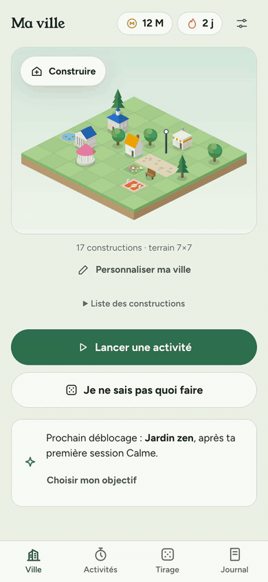

<div align="center">

🇫🇷 <a href="README.fr.md">Version française disponible ici</a>

# 🏙️ Ville du bien-être

**Grow a city by taking care of yourself.** Real-life activities with a timer earn coins, and coins build an isometric town that lights up at night.

**[▶ Try it live](https://lubachma.github.io/ville-du-bien-etre/)** — nothing to install, no account. In English or French.

100 % local — your city stays on your device (browser storage). Installable on iPhone and Android, works offline. Made to be shared with friends: everyone keeps their own city.

[](https://github.com/Lubachma/ville-du-bien-etre/actions/workflows/pages.yml)
[](LICENSE)




</div>

## ✨ Features

| Feature | Description |
|---------|-------------|
| ⏱️ **Focus** | Keep the app on screen while the timer runs (5, 10 or 20 s of grace to read a notification). Leaving longer interrupts the session: the time already done stays in the journal, without coins |
| 🚶 **Free activity** | Walk, sport, music: lock the phone or switch apps, the timer keeps going and the result is recorded when you come back — even after closing the app |
| 🎲 **Random draw** | Can't decide? Draw from your wishes (+20 %) or your chores (+50 %), filtered by available time, energy and place. One-off and recurring tasks leave the draw once done and come back on schedule |
| 🔁 **Routines** | Chain 2 to 6 activities with a free break between steps; progress survives a reload |
| 🎯 **Weekly goal** | A flexible weekly target (minutes and active days, all domains or one), plus a building to aim for; the week starts on Monday or Sunday |
| 🏗️ **City** | 50 items: 30 buildings unlocked by the minutes of their domain, the Clock Tower, 16 decorations and 3 wonders; land up to 11×11. A shop organised by section, with shortcuts and silhouettes of what comes next. Buildings level up with practice, windows light up at night. Name your city and export it as a PNG |
| 🌳 **Wonders** | Great Tree, Lighthouse and Big Wheel: one of each, built in four stages unlocked by total minutes (from 1,500 to 7,600 min). The Great Tree blossoms in the colours of the domains practised this week |
| 🧩 **Neighbourhood sets** | 12 trios to discover by placing three items within the same 3×3 square (a bench and a tree near the library, for instance); a shared paving ties them together |
| 🔨 **Lively building** | Scaffolding, dust and a small bounce on every placement; a note that rises as you place things in a row, confetti when a wonder is inaugurated. No animation when the phone asks for reduced motion |
| 📒 **Journal** | Today, streak, time done, 7-day chart, progress per domain, latest sessions |
| 🏆 **Collection and achievements** | A notebook in the Journal: 33 achievements (first steps, domains, times of day, regularity, time, city), 5 of which give a decoration; the collection of all 50 items and the sets discovered. An existing city receives the achievements it already earned in one go |
| 🌱 **Kind streak** | 0 to 2 rest days per week, a pause mode, a +20 % welcome-back gift after a break, and never a guilt message. The streak can be hidden; its bonus still applies |
| 🌍 **Languages** | English and French, following the phone or chosen in the settings. Switching is instant, without a reload; example activities you haven't renamed follow the language |
| 💾 **Backups** | Export to a file (on iPhone: “Save to Files”) or a text, restore on another device; a reminder appears after 14 days |

### Rewards

- 💰 **1 M coins** per completed minute
- 🔥 **Streak**: +10 % per active day, up to +50 %; rest days (2 per week by default) and pauses keep it going
- 🌅 **Welcome back**: +20 % on the first session that starts a new streak, after at least 2 days without one
- 🎲 **Draw**: first draw accepted +20 % (wish) or +50 % (chore) from 3 available ideas, halved on each paid re-roll
- 🧭 **5 domains** — Mind, Body, Calm, Home, Creativity (Esprit, Corps, Calme, Foyer, Créativité in French) — each unlocking its own buildings, then the Clock Tower after 1,000 minutes in total and the wonders from 1,500

## ⚙️ Settings

- **Language**: automatic (the phone's language, otherwise English), Français or English.
- **Sessions**: grace period (5, 10 or 20 s), keep the screen on, end sound (chime, bowl or bells; soft, normal or loud), vibration.
- **Streak**: rest days per week, pause, hide the streak.
- **Week and reminder**: the week starts on Monday or Sunday; a daily reminder added to your calendar (`.ics` file or Google Calendar) — the app itself sends no notifications.
- **Appearance** (auto, day, night), **strict mode** (Guided Access or app pinning), **backup** and **start over**.

## 📱 Install on a phone

1. Open **<https://lubachma.github.io/ville-du-bien-etre/>** (the HTTPS address, not an HTML file received as an attachment).
2. **iPhone**: in Safari, **Share → Add to Home Screen → Add**. **Android**: Chrome menu → **Install app** or **Add to Home screen**.
3. Launch it from its icon. In the settings, wait for **“Available offline”** before relying on offline mode.

Install it before you start: a city started in a browser tab doesn't move to the installed app by itself (transfer it with **Settings → Backup**). The in-app help lives in **Settings → Getting started and installing the app**.

## 🔒 Data & privacy

- Progress stays in the browser's local storage. No account, no analytics, no ads; the host only receives the requests needed to download the site, never your activities.
- **Settings → Backup** exports a file or a text and restores it on another device. Clearing browser data or uninstalling the app can delete the city — keep a copy.
- **VBE1** backups (first version) remain importable; **VBE2** exports also carry modes, routines and goals. A running session isn't exported.
- Progress from the first version is copied to a separate v2 storage without deleting the original, and unreadable data is preserved before any repair.

## 🚀 Quick start

```bash
npm ci
npm run build      # src/ → app.js + sw.js
npm run serve      # http://127.0.0.1:8766
```

Requires Node.js ≥ 20 for the tooling only — the published site is plain static files.

## 🛠️ Stack

Vanilla JavaScript, no framework and no runtime dependency · Canvas 2D isometric renderer · Service Worker (offline first, updates on demand) · Web Locks (one session across tabs) · Screen Wake Lock · Web Audio (end sounds) · Web Share (backup and calendar files) · Intl (plurals, dates and numbers per language) · node:test + Playwright

The build is a small Node script: it concatenates `src/` into `app.js` and stamps the service worker with a content hash.

## 📜 Scripts

| Command | Role |
|---------|------|
| `npm run build` | Generates `app.js` and `sw.js` from `src/` |
| `npm run check` | JavaScript syntax and manifest validation |
| `npm test` | Unit tests (node:test): rules, streak, translations, storage, merges, sessions, backups, calendar reminder, achievements, sets, wonders, drawings |
| `npm run test:browser` | Playwright scenarios: mobile layouts, offline under the Pages subpath, sessions, migration, updates, languages, streak, sound, reminder, notebook, wonders, shop and placement |
| `npm run board` | Drawing board in `test-results/planche/`: city by day and by night, wonders by stage, a 320 px screen, notebook thumbnails |
| `npm run serve` | Local server on port 8766 |
| `npm run package` | Prepares the deployable `dist/` folder |

Browser tests need `npx playwright install chromium`, or `PLAYWRIGHT_CHANNEL=chrome` to reuse an installed Chrome; `BROWSER=webkit` runs them on WebKit too.

**Never edit `app.js` or `sw.js` by hand** — they are generated by the build.

## 🚢 Deployment

GitHub Pages, through the **manual** workflow [`pages.yml`](.github/workflows/pages.yml): **Actions → Déployer sur GitHub Pages → Run workflow**, or `gh workflow run pages.yml`. It builds, checks, runs the unit and browser tests, then publishes only the static files of `dist/` — a push alone never publishes. All paths are relative, so `dist/` also works at the root of any static host.

Installed apps get the new version with an **“Update”** prompt, applied after the running session; the city is kept. Before sharing a version, check on a real iPhone and Android: install from the link, first offline launch, free activity with the screen locked, coming back after closing, backup/restore and update.

## 📁 Structure

```
src/
├── 00-core.js          # constants, buildings, DOM and formatting helpers
├── 05-i18n.js          # translation: t(), plurals, language choice, fixed page texts
├── 06-lang-fr.js       # French texts
├── 07-lang-en.js       # English texts
├── 10-state.js         # state, validation, 3-way merge, storage, v1 → v2 migration
├── 20-rules.js         # days, streak (rest days, pause), rewards, unlocks, prices, wonder stages
├── 22-sets.js          # neighbourhood sets: detection, paving, discovery
├── 23-achievements.js  # achievements: conditions, progress, dates
├── 30-paint.js         # isometric painter and the drawings of the first 22 items
├── 31-paint-buildings.js # drawings of the 15 new buildings
├── 32-paint-decor.js   # drawings of the 10 new decorations
├── 33-paint-wonders.js # wonder drawings, stage by stage
├── 35-city.js          # city canvas: layout, touch and keyboard, levels, placement effects, snapshot
├── 40-ui.js            # navigation, sheets, toasts, city view
├── 41-activities.js    # activities, modes, frequencies, start and edit sheets
├── 42-draw.js          # contextual random draw
├── 43-journal.js       # indicators, weekly chart, history
├── 44-shop.js          # shop, land expansion, building sheet
├── 45-settings.js      # settings sections, language switch, backups
├── 46-features.js      # weekly goals, routines, levels, personalization, PNG export
├── 47-accessibility.js # keyboard radios, focus trap
├── 48-status.js        # storage and update banners, help
├── 49-reminder.js      # daily reminder: .ics file and Google Calendar link
├── 50-session.js       # timer, focus and free modes, anti-cheat, end and placement sounds
├── 52-carnet.js        # notebook (achievements, collection, sets), celebrations, catch-up
├── 60-boot.js          # events and startup
└── 70-install.js       # install prompt, offline cache, updates
scripts/                # build, check, package, serve, service worker template
tests/                  # unit tests (VM) and Playwright scenarios
```

## 📄 License

MIT — see [LICENSE](LICENSE). Fonts Figtree and Young Serif: SIL Open Font License 1.1, texts kept in `fonts/` and in the published site.
